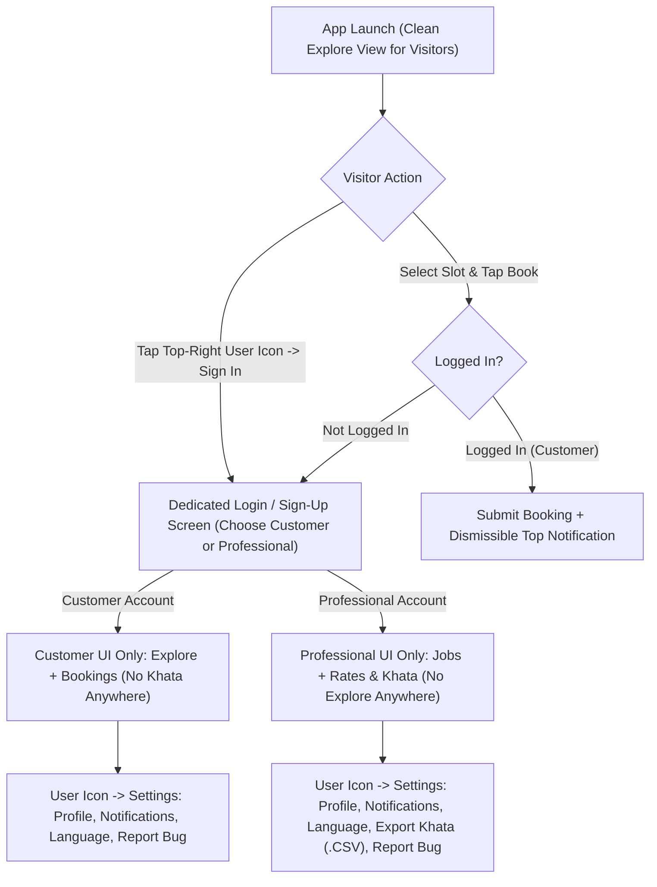
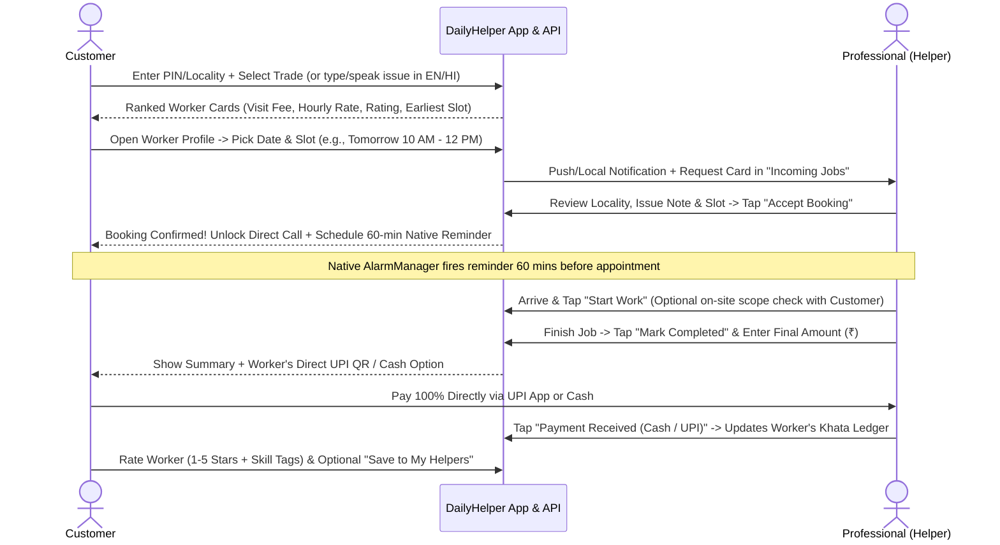
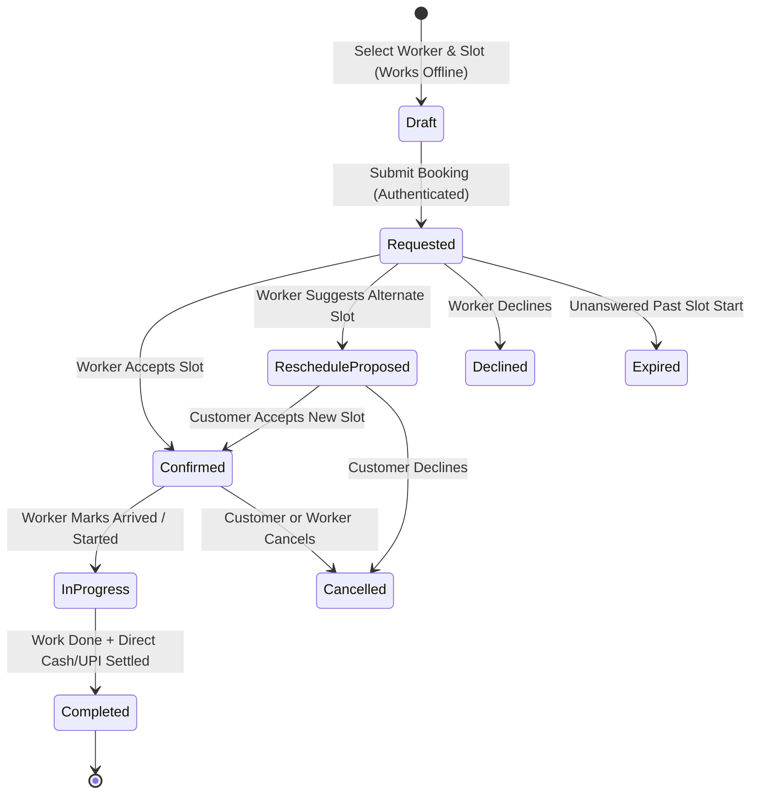

# Product Requirements Document (PRD): DailyHelper

**Product Name:** DailyHelper  
**Version:** 1.2 (Live Release Specification)  
**Date:** November 24, 2026  
**Platform:** Cross-Platform Mobile & Web (Android App, Responsive Mobile/Desktop Web PWA, Tablet Split-View)  
**Market Focus:** India-First Hyperlocal Blue-Collar Services Marketplace  

---

## 1. Executive Summary & Vision

**DailyHelper** is a hyperlocal, direct-discovery service booking platform connecting Indian households and small businesses with trusted local blue-collar professionals — including **Electricians, Plumbers, Carpenters, AC & Appliance Technicians, Painters, and Handymen**.

Unlike high-commission managed aggregators that inflate customer prices by 25–40% and penalize workers with complex rules and delayed payouts, DailyHelper empowers **direct discovery, transparent upfront visit/hourly rates, slot-based booking, and 100% direct Cash/UPI settlement** between customers and professionals inside a single, lightweight bilingual (English + Hindi) app.

> [!IMPORTANT]
> **Core MVP Product Decisions**
> - **Geography & Localization:** India-first hyperlocal matching via 6-digit PIN code & locality, **6-language Indian UI** selectable in Settings (`English`, `हिंदी`, `मराठी`, `தமிழ்`, `తెలుగు`, `ಕನ್ನಡ`), voice-keyboard friendly inputs, and Indian rate/payment norms.
> - **Discovery & Pricing Model:** **Direct Discovery & Slot Booking** — workers customize their own Visit Fee, Hourly Rate, Full-Day Rate, and custom per-service task rate cards (`Rates & Khata`), while customers browse nearby profiles, compare transparent upfront rates, and book an available slot directly.
> - **Payments & Monetization (MVP):** **Direct Cash / Worker's Own UPI QR** on job completion (`0%` payment gateway friction and `0%` commission in MVP to drive rapid worker adoption; optional Pro subscriptions/featured leads in Phase 2).
> - **App Packaging:** **Single Unified "DailyHelper" App** with strict **role-based UI separation** by account type (`Customer` vs `Professional`): Customers only see `Explore` and `Bookings` (**never `Khata`**), while Professionals only see `Jobs` and `Rates & Khata` (**never `Explore`**), with a clean **User Icon** header and a dedicated **Login / Sign-Up Screen**.

---

## 2. Problem Statement & Opportunity

### 2.1 Customer Pain Points
1. **Unreliable Word-of-Mouth:** Finding an electrician or plumber quickly in a new locality or apartment complex relies on watchmen or outdated phone numbers.
2. **Price Opacity & Haggling:** Customers rarely know a worker's base inspection/visit charge or hourly rate before calling, leading to awkward on-site disputes.
3. **Scheduling Uncertainty:** Verbal phone promises ("coming in 1 hour") turn into all-day waits without clear slot confirmation or reminders.
4. **Inflated Aggregator Markups:** Existing managed marketplaces add steep convenience fees, taxes, and minimum cart thresholds even for a 15-minute switch or tap repair.

### 2.2 Blue-Collar Professional Pain Points
1. **Inconsistent Daily Income:** Skilled independent workers experience idle afternoons between word-of-mouth referrals, with no simple digital storefront to showcase their craft and local availability.
2. **Heavy Platform Commissions & Penalties:** Aggregator apps deduct 20–35% commission, mandate expensive branded kits, lock payouts for days, and penalize workers for declining distant jobs.
3. **Literacy & UX Barriers:** Dense English-only partner apps overload workers on budget smartphones (`360×800` screens) with cluttered menus and poor offline resilience.

### 2.3 The DailyHelper Solution
A calm, fast, zero-middleman marketplace where **professionals control their own rates, service PIN codes, and time slots**, and **customers book the exact person they trust** with transparent visit charges and direct UPI/Cash settlement.

---

## 3. Target Personas & Launch Trades

### 3.1 User Personas

| Persona | Side | Profile & Device Context | Core Goal in DailyHelper |
| :--- | :--- | :--- | :--- |
| **Priya (Working Homeowner / Tenant)** | Customer | 28–45 yrs, metro/Tier-2 apartment resident; busy work hours; pays via UPI | Quickly find a rated electrician/plumber in her PIN code for a Saturday 10 AM–12 PM slot with a clear `₹150` visit fee. |
| **Rajesh (Local Shop / Clinic Owner)** | Customer | 35–55 yrs, runs a retail shop or small office; recurring maintenance needs | Keep a shortlist of reliable local carpenters/AC mechanics for quick repeat bookings without middleman markups. |
| **Ramesh (Independent Electrician)** | Professional | 24–50 yrs, budget Android phone (`360×800`), comfortable in Hindi/Hinglish, uses PhonePe/GPay QR | Fill 2–3 empty daily slots within 3–5 km (2 adjacent PIN codes), keep 100% of his earnings immediately via UPI/Cash, and track monthly income. |
| **Salim (Master Carpenter)** | Professional | 40+ yrs, high craft skill, prefers simple icons & voice input over typing long bios | Display his daily/hourly rate card, work experience, and verified badge so local families book him directly for repairs and custom woodwork. |

### 3.2 Launch Trade Categories (MVP)

| Trade Category (EN / HI) | Common Sub-Services | Typical Pricing Structure Displayed on Profile |
| :--- | :--- | :--- |
| **Electrician (`इलेक्ट्रीशियन`)** | Fan/light install, MCB/fuse trip, switchboard repair, inverter wiring, geyser point | **Base Visit Fee** (e.g., `₹99–₹199`) + **Hourly / Per-Point Rate** |
| **Plumber (`प्लंबर`)** | Tap/mixer leak, flush tank repair, pipe blockage, motor/tank fitting, sink install | **Base Visit Fee** + **Hourly Rate** (materials actuals) |
| **Carpenter (`बढ़ई / कारपेंटर`)** | Door lock/hinge fix, cupboard repair, curtain rod/drill mount, bed assembly, custom work | **Base Visit Fee** + **Hourly / Full-Day Dihadi Rate** (e.g., `₹800–₹1,200/day`) |
| **AC & Appliance Repair (`एसी / रिपेयर`)** | AC servicing/gas check, washing machine, refrigerator, RO water purifier, geyser repair | **Inspection / Service Fee** + **Standard Task Rates** |
| **Painter & Waterproofing (`पेंटर`)** | Touch-up painting, dampness/seepage fix, wall putty, single-room repaint | **Free / Nominal Inspection Visit** + **Per-Sq-Ft / Daily Rate** |
| **General Handyman / Mason (`मिस्त्री`)** | Tile/grout fix, wall drilling/TV mount, minor civil patch, net/grill fitting | **Base Visit Fee** + **Hourly / Half-Day Rate** |

---

## 4. Core User Journeys & System Flows

### 4.1 Role-Based App Architecture, Login Gate & User Menu

### 4.2 End-to-End Direct Discovery, Booking & Cash/UPI Settlement Flow

### 4.3 Booking Lifecycle State Machine

---

## 5. Detailed Functional Requirements

### 5.1 Frictionless Browsing, Role-Based Login & Account Isolation (P0 — Must Have)
- **Silent Frictionless Browsing (No Guest Banners):** Unauthenticated visitors open into a clean Explore screen with **no "Guest Mode" banner** so customers can browse helpers and rates without friction.
- **Dedicated Role-Aware Login / Sign-Up Screen:** Tapping **Book** while logged out (or tapping **User Icon → Sign In**) opens the **Login / Sign-Up Screen** where users sign in or register as a **Customer** or **Professional** (via Email/Password or Google Sign-In).
- **Strict Customer vs Professional Separation (Zero Cross-Role Clutter):**
  - **Customer Accounts** see **only** `Explore` and `Bookings`, plus Customer Settings — **Customers never see `Khata` or `Export Khata` anywhere in the app**.
  - **Professional Accounts** see **only** `Jobs` and `Rates & Khata`, plus Professional Settings (including `Export Khata (.CSV)`) — **Professionals never see the `Explore` option anywhere in the app**.
- **Clean User Icon Header:** The top app bar displays only the brand/PIN selector on the left and a clean **User Icon** on the top right (no mode text labels).
- **Strict Multi-User Isolation:** Local cache keys are strictly namespaced by `userId` and cleared from memory on sign-out so shared smartphones never leak bookings or earnings ledgers across accounts.
- **Bilingual Support (`English` / `हिंदी`):** Clean language switch inside the User Icon menu.

### 5.2 Customer Mode Requirements

| ID | Feature | Priority | Specification |
| :--- | :--- | :--- | :--- |
| **C-01** | **Hyperlocal PIN & Locality Filter** | **P0** | Filter professionals by 6-digit Indian PIN code (e.g., `560034`, `110001`) and neighborhood/locality tag. Persists last-used address locally. |
| **C-02** | **Direct Worker Discovery & Sorting** | **P0** | Clean cards displaying: Worker Name, Photo/Avatar, Trade Badges, Verified Tag, Experience (yrs), Languages (`Hindi`, `English`, etc.), **Base Visit Fee (`₹`)**, **Hourly/Day Rate (`₹`)**, Star Rating + Job Count, and **Next Available Slot**. Sort by: *Recommended*, *Lowest Visit Fee*, *Highest Rated*, *Earliest Slot*. |
| **C-03** | **`$0.00` Hybrid AI Issue Matcher** | **P0** | Interactive search/describe bar supporting English, Hindi, and Hinglish (e.g., *"kitchen tap se paani tapak raha hai"* or *"bedroom fan making noise and regulator broken"*). Automatically selects the right trade(s), tags urgency, and pre-fills the booking note for the worker. |
| **C-04** | **Transparent Worker Profile & Rate Card** | **P0** | Full view showing: Upfront Visit/Inspection Charge policy, Hourly/Full-Day rates, common task reference prices set by the worker, tools carried, customer reviews, and live 7-day slot picker. |
| **C-05** | **Slot-Based Direct Booking** | **P0** | Pick Date (Today + next 6 days) and standard 2-hour window (`8–10 AM`, `10 AM–12 PM`, `12–2 PM`, `2–4 PM`, `4–6 PM`, `6–8 PM`), enter Address + Landmark/Floor, and attach optional issue description. |
| **C-06** | **My Bookings & Direct Contact** | **P0** | Calm primary tab listing *Upcoming/Active* and *Past* bookings. Once a booking is `Confirmed`, unlocks 1-tap **Call Worker** (`tel:`) and status actions (*Reschedule*, *Cancel*, *Mark Completed & Rate*). |
| **C-07** | **My Trusted Helpers (Favorites & Repeat)** | **P1** | Bookmark reliable workers and re-book them in 2 taps from past bookings. |

### 5.3 Professional ("Helper") Mode Requirements

| ID | Feature | Priority | Specification |
| :--- | :--- | :--- | :--- |
| **W-01** | **2-Minute Worker Storefront & Rate Card** | **P0** | Guided icon-first setup: Primary & Secondary Trades, Sub-skills checklist, Serviceable PIN Codes (up to 5 nearby PINs), Experience years, Spoken Languages, **Base Visit Charge (`₹`)**, **Hourly & Full-Day Rate (`₹`)**, and optional **UPI ID (`name@upi`)** to render a direct payment QR on job completion. Includes AI Bio Generator from short voice/text keywords. |
| **W-02** | **Simple Availability & Slot Control** | **P0** | Prominent **Online / Accepting Bookings** toggle, weekly working days, active daily slots, and 1-tap "Block Today Afternoon / Take Leave" controls. Prevents double-booking confirmed slots automatically. |
| **W-03** | **Actionable Job Request Inbox** | **P0** | High-contrast incoming request cards showing Trade, Customer Sub-locality & PIN, Requested Date/Slot, Problem Note, and Visit Fee. Large touch targets: **Accept**, **Propose Another Slot**, or **Decline**. Full house number & customer phone unlock upon acceptance. |
| **W-04** | **Real-Calendar Resilience & Catch-Up** | **P0** | If a worker opens the app after multiple days offline, schedule views auto-advance to `realToday` and provide a 1-tap **"Archive Expired Requests"** catch-up banner so stale past requests never clutter today's work. |
| **W-05** | **Direct Cash/UPI Settlement & Khata Ledger** | **P0** | On job completion, worker enters final agreed amount (`₹`), displays their personal UPI QR (`upi://pay?...` deep link / QR code) or selects **Cash Received**, and logs the payment into a clean **Earnings Khata** summary (Today / This Month / Jobs Done). |
| **W-06** | **Settings-Only Khata Export** | **P1** | Export of monthly job & income history (`.csv` / `.md` / `.json`) via native Android Storage Access Framework / Share sheet — **tucked strictly inside the User Icon → Settings menu** and never shown on the primary home/khata screen. |

### 5.4 Trust, Safety & Fair-Play Rules (P0 / P1)
1. **Clear Visit-Fee Guarantee:** Every booking displays a plain-language rule in English & Hindi: *"Inspection/Visit Fee (`₹X`) is payable if you decide not to proceed after on-site diagnosis. If repair work proceeds, final labor + parts cost is agreed upfront before starting work."*
2. **Tiered Verification Badges:**
   - **Contact Verified (P0):** Verified account + active reachable phone number.
   - **ID Verified Badge (P0/P1):** Worker submits Government ID type + masked last-4 digits & trade declaration (admin/automated review queue).
   - **Top Local Pro Badge (P1):** Auto-awarded at `≥5` completed bookings with `≥4.5★` average rating and `<10%` cancellation rate.
3. **Privacy-Safe Contact Reveal:** Customer's exact flat/house number and phone number are hidden from public browsing and revealed **only** to the specific worker after a booking request is sent/accepted.
4. **Bilateral Ratings & Abuse Reporting:** Both customers and workers rate each other (`1–5★`) after completion; 1-tap "Report Issue / Misconduct" flag on every booking.

### 5.5 Notification & Alerting System (P0 — Must Have)
1. **Dismissible Top In-App Notifications:** All real-time alerts, booking confirmations, status changes, and reminders appear as clean floating notification banners **at the top of the screen** with an explicit **`✕` Dismiss** button (never permanently occupying page layout space).
2. **Event-Driven Marketplace Notifications (Customer & Professional):**
   - **Professional Alerts:** New slot booking request received, customer rescheduled or cancelled, payment confirmation & new rating received.
   - **Customer Alerts:** Professional accepted/confirmed slot, alternate slot proposed, professional marked *Work Started*, and job marked *Completed* (prompting direct UPI/Cash settlement & rating).
3. **Native Scheduled Appointment Reminders (`AlarmManager`):** Lightweight Android `AlarmManager` (`setAndAllowWhileIdle`) + Android 13+ `POST_NOTIFICATIONS` permission fires local notifications **60 minutes before confirmed appointments** for both Customer and Professional (with boot/update rescheduling via `BroadcastReceiver` and an ON/OFF toggle in Settings).

### 5.6 Uncluttered Role-Specific Views, Settings Menu & DB-Backed Bug Triage (P0)
To keep the UI calm and strictly tailored to each user's role across `360×800` phones and larger screens:
- **Strictly Separated Primary Views:**
  - **Customer App Experience (2 Tabs Only):** `Explore` (clean search, category pills, concise worker cards with name, rating, visit fee, and `Book` CTA) | `Bookings`. **No `Khata` or `Export Khata` exists anywhere for Customers.**
  - **Professional App Experience (2 Tabs Only):** `Jobs` (availability toggle, new requests, active schedule) | `Rates & Khata` (clean earnings totals + editable rates/slots — no export button on home). **No `Explore` tab or option exists anywhere for Professionals.**
- **User Icon → Settings Menu (Role-Scoped):**
  - *Shared Options:* Account Profile / Sign Out, Language (`English / हिंदी`), Notification Preferences, Fair-Play Policy, and **Report a Bug**.
  - *Professional-Only Option:* **Export Khata (`.CSV`)** (strictly hidden from Customers and tucked under Settings for Professionals).
- **DB-Logged Bug Reporting (Open-Only Visibility):**
  - Accessible under **Settings → Report a Bug**.
  - Logs bug reports directly to the PostgreSQL `bug_reports` table (`POST /api/v1/bugs` with offline local-first queue) attaching `userEmail`, `pageContext`, and `appVersion`.
  - Displays **only the signed-in user's currently open (unfixed) bugs**. Whenever an issue is fixed and marked `resolved` in our database (`PATCH /api/v1/bugs/:id`), client reconciliation (`GET /api/v1/bugs?status=all`) automatically prunes resolved tickets from local storage so **fixed bugs are never shown in the user's bug list**.

---

## 6. `$0.00` Hybrid AI Architecture

DailyHelper uses a **cost-zero (`$0.00`) 3-tier hybrid AI pipeline** so natural-language problem descriptions (including Hinglish and voice-typed Hindi) feel magical without paid API overhead or offline failure:

| Tier | Execution | Latency | Responsibility & Example |
| :--- | :--- | :--- | :--- |
| **Tier 1: Deterministic Keyword & Shorthand Parser** | On-Device (Dart) | `0 ms` (100% Offline) | Instant regex/dictionary matching across 150+ English, Hindi & Hinglish terms: *"bijli switch spark"*, *"tap leak"*, *"gyser not heating"*, *"almari lock jam tomorrow morning"* → sets Trade, Sub-skill filter, and target Date/Slot immediately. |
| **Tier 2: Compound Splitter & Trade Classifier** | On-Device (Dart) | `<5 ms` (100% Offline) | Splits multi-issue household notes (e.g., *"bathroom flush leaking and bedroom curtain rod drilling"*) into primary/secondary trade recommendations (`Plumber` + `Carpenter/Handyman`) and formats a clean bulleted job note. |
| **Tier 3: Free-Tier `gemini-2.5-flash-lite` Proxy** | Stateless Cloud Run Proxy | `≤2.8 s` timeout (Fallback to Tier 2) | Triggered only for long or ambiguous descriptions (`≥10` words) or when a worker taps **"Polish My Profile Bio"**. Extracts recommended trade, likely issue summary in both English & Hindi, and suggested inspection questions. |

---

## 7. Non-Functional, UX & Technical Architecture Requirements

### 7.1 Blue-Collar & Small-Screen UX Standards
- **Mandatory `360×800` Zero-Overflow Layout:** Every screen, worker card, Hindi Devanagari label, and slot chip must render with zero horizontal/vertical RenderFlex overflow at `360×800` logical pixels (verified via automated widget CUJ tests).
- **Responsive Tablet & Web Split-View (`≥900 px`):** Desktop/Tablet web users (e.g., apartment facility managers or shop owners) get an automatic two-column master-detail layout (Worker Directory / Job List on the left, Profile & Slot Picker / Earnings Ledger on the right).
- **High-Contrast Touch Targets:** Minimum `48×48 dp` tap targets for `Accept`, `Decline`, `Call`, and `Mark Completed` so workers can operate the app easily on the job site in bright sunlight.
- **Zero Dead Placeholders:** Every search input, filter chip, rate field, and custom task row is wired to live state — never static placeholder text.

### 7.2 Full-Stack System Blueprint
- **Frontend (`daily_helper_app/`):** Flutter (Android APK/AAB + Web PWA + Responsive Tablet), `SharedPreferences` per-user offline vault + background sync queue when connectivity returns.
- **Backend (`daily_helper_backend/`):** Stateless Node.js + Express (`server.js`) deployed on **Google Cloud Run**, backed by **Cloud SQL for PostgreSQL** (with automatic in-memory fallback for local/zero-DB boot).
- **Core Data Entities (`schema.sql`):**
  - `users` (`id`, `email`, `phone`, `name`, `preferred_lang`, `active_role`, `password_hash`, `google_sub`)
  - `worker_profiles` (`user_id`, `trades[]`, `skills[]`, `service_pins[]`, `locality_name`, `visit_fee_inr`, `hourly_rate_inr`, `daily_rate_inr`, `upi_id`, `bio_en`, `bio_hi`, `experience_years`, `verification_tier`, `is_online`, `availability_json`, `rating_avg`, `jobs_completed`)
  - `bookings` (`id`, `customer_id`, `worker_id`, `trade`, `pin_code`, `address_summary`, `full_address`, `booking_date`, `slot_window`, `issue_note`, `agreed_visit_fee_inr`, `final_amount_inr`, `payment_method`, `status`, `customer_rating`, `worker_rating`, `created_at`, `updated_at`)
  - `notifications` (`id`, `user_id`, `booking_id`, `title`, `body`, `type`, `is_dismissed`, `created_at`)
  - `bug_reports` (`id`, `user_email`, `page_context`, `app_version`, `description`, `status`, `resolution_notes`, `created_at`, `resolved_at`)

---

## 8. Monetization Roadmap

> [!TIP]
> **Why `0%` Commission in MVP Wins Hyperlocal Supply**  
> Blue-collar marketplaces fail or succeed on **local worker density per PIN code**. Eliminating payment gateway holds and platform commissions in Phase 1 gives every electrician, carpenter, and plumber an immediate reason to onboard and share their DailyHelper profile with local customers.

| Phase | Timeline | Revenue Mechanism | Value Delivered |
| :--- | :--- | :--- | :--- |
| **Phase 1: Liquidity MVP** | Launch | **`₹0` Free for Customers & Workers** (100% Direct Cash/UPI to Worker) | Rapid neighborhood supply density, habit formation, organic word-of-mouth referrals. |
| **Phase 2: Pro Subscriptions** | Post-PMF (1,000+ active workers) | **Helper Pro Pass (`₹99–₹199/month`)** | Featured top-of-PIN placement, fast-track ID verification badge, expand from 3 to 10 PIN codes, downloadable branded digital visiting card. |
| **Phase 3: B2B & Value-Added Ecosystem** | Scale | **Shop/Society Maintenance Plans & Partner Perks** | Annual maintenance dashboards for small offices/RWAs; hardware/electrical supplier discount partnerships and optional job warranty cover. |

---

## 9. Success Metrics (KPIs) & Rollout Plan

### 9.1 Key Performance Indicators
- **North Star Metric:** **Completed & Rated Bookings per Active PIN Code per Week**.
- **Supply Health:** Worker onboarding completion rate (`>75%` under 3 minutes), `%` of workers updating availability weekly, 30-day worker retention (`>60%`).
- **Demand & Liquidity:** Search-to-Booking conversion rate (`>20%`), Slot Request Acceptance rate (`>70%` within 30 minutes), Repeat Customer Booking rate within 60 days (`>35%`).
- **Engineering Quality:** `0` crashes, `0` layout overflows at `360×800`, `<200 ms` local UI interaction latency, `100%` passing automated CUJ test suite.

### 9.2 Phased Delivery Plan
1. **Milestone 1 — Core MVP App & Stateless Cloud Backend:** Unified Customer + Professional Flutter app (`Android` + `Web`), seeded starter local demo workers per PIN so Day-1 exploration works out of the box alongside live registered workers, Direct Slot Booking lifecycle, Direct UPI QR / Cash Khata ledger, Bilingual EN/HI toggle, and `$0.00` Hybrid AI Issue Matcher.
2. **Milestone 2 — Native Polish & Verification:** Android native `AlarmManager` 60-minute slot reminders, SAF `.csv`/`.md` worker earnings export, ID verification submission flow, and Closed-Loop In-App Bug Triage.
3. **Milestone 3 — Play Store Release Kit:** `360×800` automated CUJ test verification, signed `.aab`/`.apk` builds, Play Store assets, and hyperlocal pilot rollout.
